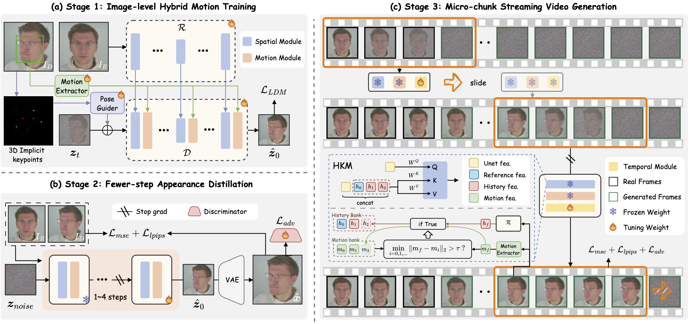

# PersonaLive (Unofficial Blackwell/GB10 Support)

> **⚠️ NOTE:** This is a modified fork of the original [PersonaLive by GVCLab](https://github.com/GVCLab/PersonaLive). All credit for the model architecture and core logic belongs to the original authors. This repository adds support for **NVIDIA Blackwell (GB10, DGX Spark)** and mixed-GPU setups (RTX 3090/4090), and keeps the dependencies free of known vulnerabilities.

## What this fork changes

* **Blackwell (GB10) support:** PyTorch 2.13 and later run on GB10 (sm_121) as shipped; nothing patches installed packages.
* **Multi-GPU launcher:** `launcher.py` detects GPUs and isolates each process on one (fixes crashes when mixing GB10s with RTX cards).
* **Auto-compilation:** compiles the TensorRT engine for your GPU on first launch and caches it per GPU model.
* **FP32/FP16 auto-casting:** fixes `cuMemcpy` crashes caused by precision mismatches in the original inference pipeline.
* **Secure by default:** hash-pinned dependencies with no known advisories, a plain HTML/JavaScript web page with no npm or third-party code, and a webcam server that listens on this machine only and needs an access key. See [SECURITY.md](SECURITY.md).

## Installation

Needs Python 3.12 or later, an NVIDIA driver for CUDA 13, and `ffmpeg` for saving videos with audio. The lock file covers Linux x86_64, Linux aarch64 (DGX Spark) and Windows x86_64.

```bash
git clone https://github.com/chappa-ai-llc/PersonaLive-Blackwell.git
cd PersonaLive-Blackwell
python3 -m venv .venv
source .venv/bin/activate
pip install --require-hashes -r requirements.txt
```

`requirements.txt` pins every package to one version with its SHA-256 hashes, and pip refuses anything else. The TensorRT libraries arrive through NVIDIA's installer package, which downloads them from `pypi.nvidia.com` and checks them against that index's hashes (SECURITY.md, "Dependencies").

### Download the weights

```bash
python tools/download_weights.py
```

It downloads each file from a fixed Hugging Face commit and checks its SHA-256 against `tools/weights.lock.json`. Until those pins are recorded (SECURITY.md, "Model weights"), it says so and downloads nothing.

### Launch

```bash
python launcher.py
```

The launcher picks the GPU (it asks when there are several), builds the TensorRT engine on first use (10 to 20 minutes), and starts the webcam server. The server prints an address with a one-time access key, such as `http://127.0.0.1:7860/#key=...`: open it in your browser.

## Running the webcam server

```bash
python inference_online.py --acceleration tensorrt
```

Use `--acceleration none` for plain PyTorch attention (no engine needed).

**How to use**: choose a portrait ➡️ Fuse reference ➡️ Start animation ➡️ Enjoy! 🎉

| Option | Environment variable | Default | What it does |
|---|---|---|---|
| `--host` | `HOST` | `127.0.0.1` | Address to listen on. Any address other than this machine needs TLS (below). |
| `--port` | `PORT` | `7860` | Port. |
| `--access-key-file` | `PERSONALIVE_ACCESS_KEY_FILE` | none | File with the access key (at least 32 characters, mode 600). Without it, a new key is made for each run and printed with the address. |
| `--ssl-certfile`, `--ssl-keyfile` | `SSL_CERTFILE`, `SSL_KEYFILE` | none | TLS certificate chain and private key (PEM). |
| `--max-queue-size` | `MAX_QUEUE_SIZE` | `1` | Most browser sessions at once. |
| `--acceleration` | `ACCELERATION` | `none` | `none`, `tensorrt`, or `xformers` (only with an xFormers build that matches your PyTorch; none is installed). |

**From another machine.** Browsers allow the camera only on `https://` pages or on `localhost`, so remote use needs TLS, and the server refuses to listen on another address without it. Use a certificate your browser trusts (for example one from your own CA), keep its key file readable by you only, and keep the access key in a file:

```bash
python -c "import secrets; print(secrets.token_urlsafe(32))" > ~/.personalive_key
chmod 600 ~/.personalive_key
python inference_online.py --host 0.0.0.0 --ssl-certfile cert.pem --ssl-keyfile key.pem --access-key-file ~/.personalive_key
```

Then open `https://<this machine>:7860/` and enter the key.

## Offline inference

```bash
python inference_offline.py
```

* `-L`: Max number of frames to generate. (Default: 100)
* `--use_xformers`: Use xFormers attention; needs an xFormers build that matches your PyTorch. (Default: off)
* `--stream_gen`: Enable streaming generation strategy. (Default: True)
* `--reference_image`: Path to a specific reference image. Overrides settings in config.
* `--driving_video`: Path to a specific driving video. Overrides settings in config.

Faces are cropped with the model's own keypoint detector (LivePortrait), as in the webcam path.

## TensorRT acceleration

`launcher.py` builds the engine for you. To build it by hand:

```bash
python torch2trt.py
```

TensorRT can roughly double the speed. Building the engine takes about 20 minutes, and its optimizations may cause slight variations or a small drop in output quality. Build it again on each GPU model you use.

## Checking an upgrade

```bash
python -m unittest discover -s tests -v
python tools/smoke_random_weights.py scratchpad/smoke
```

The first runs the webcam server's security tests; the second runs the whole online pipeline on CPU with random weights (a few minutes, about 8 GB of disk). After changing a dependency in `pyproject.toml`, regenerate the lock with `tools/lock.sh` and run both.

---

<div align="center">


<h2>Expressive Portrait Image Animation for Live Streaming</h2>

#### [Zhiyuan Li<sup>1,2,3</sup>](https://huai-chang.github.io/) · [Chi-Man Pun<sup>1,📪</sup>](https://cmpun.github.io/) · [Chen Fang<sup>2</sup>](http://fangchen.org/) · [Jue Wang<sup>2</sup>](https://scholar.google.com/citations?user=Bt4uDWMAAAAJ&hl=en) · [Xiaodong Cun<sup>3,📪</sup>](https://vinthony.github.io/academic/) 
<sup>1</sup> University of Macau  &nbsp;&nbsp; <sup>2</sup> [Dzine.ai](https://www.dzine.ai/)  &nbsp;&nbsp; <sup>3</sup> [GVC Lab, Great Bay University](https://gvclab.github.io/)

<a href='https://arxiv.org/abs/2512.11253'></a> <a href='https://huggingface.co/huaichang/PersonaLive'></a> <a href='https://modelscope.cn/models/huaichang/PersonaLive'></a> [](https://github.com/GVCLab/PersonaLive)


 &nbsp;&nbsp; 
</div>

## ⚙️ Framework



We present PersonaLive, a `real-time` and `streamable` diffusion framework capable of generating `infinite-length` portrait animations on a single `12GB GPU`.


## ⏬ Weights from the upstream authors

The upstream authors also publish the weights at these links. Files downloaded by hand are not checked against `tools/weights.lock.json`; `tools/download_weights.py` is the verified route.
    
<a href='https://drive.google.com/drive/folders/1GOhDBKIeowkMpBnKhGB8jgEhJt_--vbT?usp=drive_link'></a> <a href='https://pan.baidu.com/s/1DCv4NvUy_z7Gj2xCGqRMkQ?pwd=gj64'></a> <a href='https://modelscope.cn/models/huaichang/PersonaLive'></a> <a href='https://huggingface.co/huaichang/PersonaLive'></a>

The weights end up organized like this:
```
pretrained_weights
├── onnx
│   ├── unet_opt
│   │   ├── unet_opt.onnx
│   │   └── unet_opt.onnx.data
│   └── unet
├── personalive
│   ├── denoising_unet.pth
│   ├── motion_encoder.pth
│   ├── motion_extractor.pth
│   ├── pose_guider.pth
│   ├── reference_unet.pth
│   └── temporal_module.pth
├── sd-vae-ft-mse
│   ├── diffusion_pytorch_model.bin
│   └── config.json
├── sd-image-variations-diffusers
│   ├── image_encoder
│   │   ├── pytorch_model.bin
│   │   └── config.json
│   ├── unet
│   │   ├── diffusion_pytorch_model.bin
│   │   └── config.json
│   └── model_index.json
└── tensorrt
    └── unet_work.engine
```

## ⏱️ Latency

Latency varies depending on your device's computing power. You can try the following methods to optimize it:

1. Lower the "Driving FPS" setting in the WebUI to reduce the computational workload.
2. You can increase the multiplier (e.g., set to `num_frames_needed * 4` or higher) to better match your device's inference speed. https://github.com/GVCLab/PersonaLive/blob/6953d1a8b409f360a3ee1d7325093622b29f1e22/webcam/util.py#L73

## 📚 Community Contribution

Special thanks to the community for providing helpful setups! 🥂

* **Windows + RTX 50-Series Guide**: Thanks to [@dknos](https://github.com/dknos) for providing a [detailed guide](https://github.com/GVCLab/PersonaLive/issues/10#issuecomment-3662785532) on running this project on Windows with Blackwell GPUs.

* **TensorRT on Windows**: If you are trying to convert TensorRT models on Windows, [this discussion](https://github.com/GVCLab/PersonaLive/issues/8) might be helpful. Special thanks to [@MaraScott](https://github.com/MaraScott) and [@Jeremy8776](https://github.com/Jeremy8776) for their insights.
  
* **ComfyUI**: Thanks to [@okdalto](https://github.com/okdalto) for helping implement the [ComfyUI-PersonaLive](https://github.com/okdalto/ComfyUI-PersonaLive) support.

## 🎬 More Results
#### 👀 Visualization results

<table width="100%">
  <tr>
    <td width="50%">
      <video src="https://github.com/user-attachments/assets/cdc885ef-5e1c-4139-987a-2fa50fefd6a4" controls="controls" style="max-width: 100%; display: block;"></video>
    </td>
    <td width="50%">
      <video src="https://github.com/user-attachments/assets/014f7bae-74ce-4f56-8621-24bc76f3c123" controls="controls" style="max-width: 100%; display: block;"></video>
    </td>
  </tr>
</table>
<table width="100%">
  <tr>
    <td width="25%">
      <video src="https://github.com/user-attachments/assets/1e6a0809-15d2-4cab-ae8f-8cf1728c6281" controls="controls" style="max-width: 100%; display: block;"></video>
    </td>
    <td width="25%">
      <video src="https://github.com/user-attachments/assets/d9cf265d-9db0-4f83-81da-be967bbd5f26" controls="controls" style="max-width: 100%; display: block;"></video>
    </td>
    <td width="25%">
      <video src="https://github.com/user-attachments/assets/86235139-b63e-4f26-b09c-d218466e8e24" controls="controls" style="max-width: 100%; display: block;"></video>
    </td>
    <td width="25%">
      <video src="https://github.com/user-attachments/assets/238785de-3b4c-484e-9ad0-9d90e7962fee" controls="controls" style="max-width: 100%; display: block;"></video>
    </td>
  </tr>
  <tr>
    <td width="25%">
      <video src="https://github.com/user-attachments/assets/c71c4717-d528-4a98-b132-2b0ec8cec22d" controls="controls" style="max-width: 100%; display: block;"></video>
    </td>
    <td width="25%">
      <video src="https://github.com/user-attachments/assets/7e11fe71-fd16-4011-a6b2-2dbaf7e343fb" controls="controls" style="max-width: 100%; display: block;"></video>
    </td>
    <td width="25%">
      <video src="https://github.com/user-attachments/assets/f62e2162-d239-4575-9514-34575c16301c" controls="controls" style="max-width: 100%; display: block;"></video>
    </td>
    <td width="25%">
      <video src="https://github.com/user-attachments/assets/813e7fbd-37e9-47d7-a270-59887fafeca5" controls="controls" style="max-width: 100%; display: block;"></video>
    </td>
  </tr>
</table>

#### 🤺 Comparisons

<table width="100%">
  <tr>
    <td width="100%">
      <video src="https://github.com/user-attachments/assets/36407cf9-bf82-43ff-9508-a794d223d3f7" controls="controls" style="max-width: 100%; display: block;"></video>
    </td>
  </tr>
  <tr>
    <td width="100%">
      <video src="https://github.com/user-attachments/assets/3be99b91-c6a1-4ca4-89e9-8fad42bb9583" controls="controls" style="max-width: 100%; display: block;"></video>
    </td>
  </tr>
  <tr>
    <td width="100%">
      <video src="https://github.com/user-attachments/assets/5bd21fe4-96ae-4be6-bf06-a7c476b04ec9" controls="controls" style="max-width: 100%; display: block;"></video>
    </td>
  </tr>
</table>


## ⭐ Citation
If you find PersonaLive useful for your research, welcome to cite our work using the following BibTeX:
```bibtex
@article{li2025personalive,
  title={PersonaLive! Expressive Portrait Image Animation for Live Streaming},
  author={Li, Zhiyuan and Pun, Chi-Man and Fang, Chen and Wang, Jue and Cun, Xiaodong},
  journal={arXiv preprint arXiv:2512.11253},
  year={2025}
}
```

## ❤️ Acknowledgement
This code is mainly built upon [Moore-AnimateAnyone](https://github.com/MooreThreads/Moore-AnimateAnyone), [X-NeMo](https://byteaigc.github.io/X-Portrait2/), [StreamDiffusion](https://github.com/cumulo-autumn/StreamDiffusion), [RAIN](https://pscgylotti.github.io/pages/RAIN/) and [LivePortrait](https://github.com/KlingTeam/LivePortrait), thanks to their invaluable contributions.


