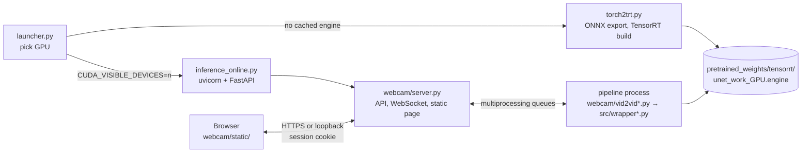

# PersonaLive-Blackwell — Master Design Document
**Version:** 1.2.0
**Status:** Active
**Owner:** chappa.ai LLC
**As of:** 2026-11-09, code release 0.2.1

## --help
**Document Type:** Master Design Document
**Project:** PersonaLive-Blackwell (BUILD office slug `personalive-blackwell`, repo `chappa-ai-llc/PersonaLive-Blackwell`, **public**)
**Your task:** Read only the chapter or chapters your work needs.
**Orchestrator:** read §3 (Roadmap) and §11 (Agent Orientation) first.
**Sub-agent:** your brief names a chapter. Go straight to it.
**Quick Index:** [§1 Overview] [§2 Architecture] [§5 Interfaces] [§7 Security] [§10 Known Issues] [§11 Agent Rules]

## Table of Contents

| § | Chapter | Summary | Agent hint |
|---|---|---|---|
| §1 | Project Overview | What the fork is, why it exists, and who it is for. | Everyone: read first. |
| §2 | Architecture | The launcher, engine build, webcam server and pipeline process, and how they connect. | Pipeline or launcher work: read §2 and §4. |
| §3 | Milestones & Roadmap | What shipped and what is next. | Orchestrator. |
| §4 | Component Specifications | Each module and what it is responsible for. | Changing a module: read its section. |
| §5 | API & Interface Contracts | The webcam server's HTTP and WebSocket API, the CLI options and the files. | Web page or server work. |
| §6 | Data Models | Config files, weights and engine files, and the lock files. | Dependency or weight work. |
| §7 | Security & Compliance | The threat model and controls; points to `SECURITY.md`. | Read before any server, dependency or weight change. |
| §8 | Deployment & Operations | Install, run and release. | Release work. |
| §9 | Testing Strategy | What the tests cover, and the smoke test. | Before merging anything. |
| §10 | Known Issues & Technical Debt | Open items, with their issues. | Picking up work. |
| §11 | Agent Orientation | Project rules for agents, role map and handoffs. | Every agent. |
| §12 | Change Log | Versions of this document. | Editing this document. |

## §1 — Project Overview

§1.1 **What.** A fork of [GVCLab/PersonaLive](https://github.com/GVCLab/PersonaLive). PersonaLive does real-time portrait animation: one reference photo, driven live by a webcam (online) or by a video (offline), using a diffusion model (a Stable Diffusion image-variations UNet with a reference UNet, a motion encoder, a pose guider and a temporal module). The fork adds NVIDIA Blackwell support (DGX Spark GB10, sm_121), mixed-GPU support (GB10 alongside RTX 3090/4090), a cached TensorRT engine for each GPU model, and a dependency set with no known vulnerabilities.

§1.2 **Why.** Upstream does not run as-is on GB10, and on 2026-11-08 the office's scan found 373 open advisories in its dependency tree (including an npm SvelteKit front end). Release 0.1.0 brought that to 0 and removed npm.

§1.3 **Who.** The owner, and anyone with an NVIDIA GPU who wants live portrait animation. It is a desktop tool that runs on the user's own machine, not a hosted service. It has no accounts and no admin (decided: board card X-02).

§1.4 **Credit and licence.** The model architecture and weights belong to the upstream authors; see `LICENSE` and the README citation.

## §2 — Architecture

§2.1 **Process model.** `launcher.py` lists GPUs with `nvidia-smi` (it never initialises PyTorch, which crashed on mixed GPUs). It then runs every child (`torch2trt.py`, `inference_online.py`) with `CUDA_VISIBLE_DEVICES` set to the one chosen GPU, so each process sees it as `cuda:0`.

§2.2 **Engine cache.** `pretrained_weights/tensorrt/unet_work.engine` is the active engine. `launcher.py` keeps one copy per GPU model, `unet_work_<sanitised GPU name>.engine`, and copies the matching one into place. With no copy, it runs `torch2trt.py` (10 to 20 minutes) and caches the result.

§2.3 **Webcam server.** `inference_online.py` checks the TLS and access-key rules (§7), builds the pipeline, then serves `webcam.server.build_app()` with uvicorn. The model runs in a separate process started with `spawn` (`webcam/vid2vid.py`, or `vid2vid_trt.py` with `--acceleration tensorrt`). Frames cross the process boundary through `multiprocessing.Queue`s: input, output and reference. A thread in the server moves finished frames to the WebSocket, paced between 10 and 30 fps.

§2.4 **Offline path.** `inference_offline.py` animates a reference image from a driving video, using `Pose2VideoPipeline` / `Pose2VideoPipeline_Stream` (`src/pipelines/`). Faces are cropped by `src.utils.util.crop_face` with the LivePortrait keypoint detector, and frames are read with PyAV (`read_video_frames`).

## §3 — Milestones & Roadmap

The BUILD board timeline is the live view (https://build.chappa.ai/p/personalive-blackwell).

| Phase | What | Status |
|---|---|---|
| Upstream fork | GB10 support, multi-GPU launcher, per-GPU engine cache, FP32/FP16 casting fixes | done (before 0.1.0) |
| P1 Security sweep | Hash lock, npm-free page, hardened webcam server, `weights_only` loads, pinned weight download | done, 0.1.0 (2026-11-08) |
| P0 Onboard | Board, MDD, first tagged release | in progress |
| P2 GPU validation | Weight pins (#2), TensorRT wheel lock (#3), end-to-end on GB10 and RTX (#4) | planned, waits on board card A-01 |

## §4 — Component Specifications

| Path | Responsibility |
|---|---|
| `launcher.py` | GPU detection (`nvidia-smi`), GPU choice (`--gpu N` or a prompt), engine cache, starts the server with `--acceleration tensorrt` unless told otherwise. |
| `torch2trt.py` | Builds the UNet work model (`src/modeling/framed_models.unet_work`), exports ONNX (opset 17, `src/modeling/onnx_export.py`), builds the TensorRT engine with Polygraphy. Paths come from `configs/prompts/personalive_online.yaml`. |
| `inference_online.py` | Entry point of the webcam server: argument checks, access key, TLS ciphers, signal handling, uvicorn. |
| `webcam/config.py` | `parse_args()`: CLI options and their environment variables (§5.3). |
| `webcam/server.py` | `build_app()`: routes, WebSocket loop, output pacing. Holds no model code, so tests run it with a stand-in pipeline. |
| `webcam/security.py` | `AccessGuard` (key, sessions, lockout), `SecurityHeadersMiddleware`, `same_origin`, `decode_image`, `load_access_key`. No GPU or model imports. |
| `webcam/connection_manager.py` | Per-session WebSocket and queues; refuses sessions past `--max-queue-size`. |
| `webcam/vid2vid.py`, `vid2vid_trt.py` | The pipeline process: fuse the reference, then turn webcam frames into animated frames (`src/wrapper.py` / `src/wrapper_trt.py`, class `PersonaLive`). |
| `webcam/preferences.py` | `PreferenceStore`: the page's appearance (theme, mode, scale, type), validated against the vendored style files and saved atomically to `--prefs-file`. |
| `webcam/static/` | The page: `index.html`, `app.js` (sign-in, camera, stream), `appearance.js` (paints the cached look before the page shows), `preferences.js` (profile menu, Preferences dialog), `app.css`. Plain files, no build step, no third-party code. |
| `webcam/static/style/` | Vendored from `chappa-ai-llc/style-guide` by `sg.py vendor`: `themes.css`, `fonts/` (woff2 and OFL licences), `type.json`, `vendor.json` (versions and SHA-256). Never edited by hand. |
| `tools/check_style.py` | Checks `webcam/static/style/` against `vendor.json`, and runs the style guide's `audit-css` on each theme. |
| `src/models/`, `src/pipelines/`, `src/scheduler/` | Model code from upstream (UNet 2D/3D, motion module, pose guider, motion encoder, DDIM scheduler). |
| `src/liveportrait/` | LivePortrait motion extractor (keypoints), used for face boxes and motion. |
| `src/modeling/` | TensorRT engine wrapper and ONNX export helpers. |
| `tools/download_weights.py` | Pinned, hash-checked weight download; `--pin` records pins (maintainers). |
| `tools/lock.sh` | Regenerates `requirements.txt` with uv (from `PATH`, or the binary named in `UV`; agents set `UV` to the pinned uv). |
| `tools/release.sh` | Checks, then makes the signed release tag with the version's notes as its message (§8.3). |
| `tools/smoke_random_weights.py` | The whole online pipeline on CPU with random weights. |

## §5 — API & Interface Contracts

§5.1 **HTTP API** (`webcam/server.py`). Every `/api` route except `POST /api/session` needs the session cookie `personalive_session`.

| Method and path | Request | Response |
|---|---|---|
| `POST /api/session` | JSON `{"key": "<access key>"}`, at most 4096 bytes, same Origin | `204` and an HttpOnly, SameSite=Strict cookie (12 h); `401` wrong key; `429` locked out |
| `POST /api/logout` | none | closes the session |
| `GET /api/settings` | none | frame size and queue limit for the page |
| `GET /api/queue` | none | number of connected sessions |
| `GET /api/preferences` | none | the appearance, `{"theme", "mode", "scale", "type": {"head", "body", "label", "heading", "text"}}` (§6.4) |
| `PUT /api/preferences` | JSON with only the fields that change, at most 4096 bytes, same Origin | the stored object; `400` with the reason for an unknown field or value |
| `POST /api/upload_reference_image` | multipart, field `ref_image`: JPEG, PNG or WebP, at most 10 MB and 4096 px a side | fuses the reference |
| `GET /` | none | the static page |

§5.2 **WebSocket** `GET /api/ws/{user_id}` (`user_id` is a UUID). Needs the same Origin and a valid session, else it closes with code 1008. Client to server: binary messages are webcam frames (JPEG, at most 2 MB); text messages are JSON `{"status": "pause"}` or `{"status": "resume"}`. Server to client: JSON status messages (`connected`, `send_frame`, `error`) and binary JPEG output frames.

§5.3 **CLI** (`webcam/config.py`; the README table is the user-facing copy). `--host` (`HOST`, default `127.0.0.1`), `--port` (`PORT`, `7860`), `--access-key-file` (`PERSONALIVE_ACCESS_KEY_FILE`), `--ssl-certfile` / `--ssl-keyfile` (`SSL_CERTFILE` / `SSL_KEYFILE`), `--max-queue-size` (`MAX_QUEUE_SIZE`, `1`), `--prefs-file` (`PERSONALIVE_PREFS_FILE`, default `personalive/preferences.json` under `~/.config` or `%APPDATA%`), `--acceleration` (`ACCELERATION`: `none`, `tensorrt` or `xformers`). `launcher.py` takes `--gpu N` and passes everything else through.

## §6 — Data Models

§6.1 **Configs.** `configs/prompts/personalive_online.yaml` and `personalive_offline.yaml` hold the weight paths, the ONNX path (`./pretrained_weights/onnx/unet/unet.onnx`) and the engine path (`./pretrained_weights/tensorrt/unet_work.engine`). `configs/inference/inference_stage3.yaml` holds the scheduler and model settings.

§6.2 **Weights.** Under `pretrained_weights/` (git-ignored), from three Hugging Face repos: `huaichang/PersonaLive`, `lambdalabs/sd-image-variations-diffusers` and `stabilityai/sd-vae-ft-mse`. `tools/weights.lock.json` maps each repo to a commit `revision` and each file to a SHA-256 (all `null` today: §10).

§6.3 **Dependencies.** `pyproject.toml` lists the direct dependencies, with floors at the first release that fixed every known advisory, and transitive floors under `[tool.uv] constraint-dependencies`. `requirements.txt` is the full uv lock with hashes, for Linux x86_64, Linux aarch64 and Windows x86_64. The filename must stay `requirements*.txt` so dep-audit and Dependabot read it.

§6.4 **Appearance preference.** One record, because the server has one user (the access key holder). `theme` is `auto` or a theme id in `webcam/static/style/vendor.json`; `auto` means High contrast when `prefers-contrast: more` matches, else Modernist. `mode` is `system`, `light` or `dark`. `scale` is one of 0.8, 0.9, 1, 1.1, 1.25, 1.5, 1.75, 2 (CSS `zoom` on `<html>`, with `--zoom` for viewport lengths). `type.head` and `type.body` are `theme` or a font id from `type.json` allowed for that role; `type.heading` is `theme` or `compact`, `regular`, `large`; `type.label` (9 to 13) and `type.text` (13 to 16) are pixel sizes, 0 for the theme's own. The page caches the record and the resolved type properties in `localStorage` (`personalive.appearance`) for first paint only. A field in the file that is no longer valid falls back to its default on load.

## §7 — Security & Compliance

`SECURITY.md` is the authority. This chapter is the summary.

§7.1 **Threat model.** One user on their own machine. The assets are the webcam stream, the uploaded portrait and the GPU. The threats are other hosts on the network, malicious web pages in the same browser (CSRF, cross-site WebSocket), malformed images, pickled code in checkpoints, and compromised or vulnerable dependencies.

§7.2 **Controls.**
- §7.2.a Listens on 127.0.0.1 by default. Any other address needs TLS, or the server refuses to start. TLS 1.2 is limited to forward-secret AEAD suites (`ECDHE+AESGCM:ECDHE+CHACHA20`). Decided: board card X-03.
- §7.2.b The access key is always needed: new for each run (printed once, kept in memory), or read from a file of at least 32 characters that other users cannot read (the `*_FILE` convention). Ten wrong keys in a minute lock that client out for the rest of the minute.
- §7.2.c Same origin only: no CORS, and `Origin` is checked on sign-in, uploads and the WebSocket.
- §7.2.d Security headers on every response: a strict CSP (`script-src 'self'`, `style-src 'self'`, `font-src 'self'`), `frame-ancestors 'none'`, `nosniff`, `Referrer-Policy: same-origin`, a Permissions-Policy, and HSTS over TLS. No `Server` header, no OpenAPI or docs routes.
- §7.2.e Bounded image decoding: format allow-list, byte and pixel limits, headers checked before pixels are decoded.
- §7.2.f Every checkpoint is loaded with `torch.load(..., weights_only=True)`. Weights are downloaded at pinned commits with SHA-256 checks.
- §7.2.g Full hash lock, no npm, Dependabot on, and the office's dep-audit runs hourly. No installed package is patched in place (the old `apply_patches.py` was removed).

§7.3 **Standards not applied, by decision.** There is no security self-check page and no BUILD link, because the page is a local tool, not an admin dashboard (board card X-02). The owner may overturn that.

§7.4 **Reporting.** GitHub private vulnerability reporting (SECURITY.md).

## §8 — Deployment & Operations

§8.1 **Install and run.** As in the README: `pip install --require-hashes -r requirements.txt`, `python tools/download_weights.py`, `python launcher.py`. Needs Python 3.12 or later, a CUDA 13 driver and `ffmpeg`.

§8.2 **No Swarm deployment.** This is a desktop or Spark tool. Nothing runs on the lab Swarm. Outside the repo folder the server writes only the appearance preference (`--prefs-file`, §6.4).

§8.3 **Release.** Agents release (global rules). Add the version's section to `CHANGELOG.md`, opening with a `**Purpose:**` line written for a stranger (the repo is public: no internal systems, hosts or tools named), and set `version` in `pyproject.toml`. Merge to main and push, then run `tools/release.sh X.Y.Z`: it checks main, the version and the section, runs the tests and the style integrity check, and makes the signed tag with the section as its message. Push the tag as a command of its own. The GitHub release page carries the same notes. There are no build artifacts: users install from the tagged source, and `SECURITY.md` ("Verifying a release") tells them how to check the signature. No GitHub Actions.

§8.4 **Changing a dependency.** Edit `pyproject.toml`, run `tools/lock.sh`, then run both checks in §9.

## §9 — Testing Strategy

§9.1 `python -m unittest discover -s tests -v`: the webcam server's tests, through the in-process ASGI client `tests/asgi_client.py` with a stand-in pipeline. `tests/test_security.py` covers the security controls (34 tests); `tests/test_appearance.py` covers the preference API, the vendored style files, bare viewport units, external loads and colours in `app.css` (16 tests). They need no GPU.

§9.2 `python tools/smoke_random_weights.py <out-dir>`: the whole online pipeline on CPU with random weights (a few minutes, about 8 GB of disk). Run it after every dependency change.

§9.3 **Not automated:** GPU runs, the TensorRT build, real-weight output quality (#4).

§9.4 `python tools/check_style.py --style-guide <clone of chappa-ai-llc/style-guide>`: the vendored files match `vendor.json`, and `sg.py audit-css` passes for every theme (`--aaa` for High contrast). `--integrity-only` skips the audit when no clone is at hand.

## §10 — Known Issues & Technical Debt

| Item | Issue |
|---|---|
| Weight pins not recorded, so `tools/download_weights.py` downloads nothing yet. The pod cannot reach Hugging Face. | #2 (board A-01) |
| TensorRT wheels arrive through NVIDIA wheel-stubs; the lock covers the stub, not the wheel. | #3 (board A-01) |
| 0.1.0 not yet run on a GPU (torch 2.15, TensorRT 10.16, diffusers 0.42, transformers 5.22, new offline crop). | #4 |
| Page styling is minimal; style-guide adoption is optional. | #5 |
| `src/wrapper.py` and `src/wrapper_trt.py` duplicate most of their code, as in upstream. | none yet |

## §11 — Agent Orientation

§11.1 **Checklist at session start.** Board `inbox`, `stale`, `answered`, `security --phases` and `push`; then forum `inbox`; then the newest handoff (global rules).

§11.2 **Project rules.**
- §11.2.a The repo is **public**, by the owner's choice (board card D-01, 2026-11-08). Never commit secrets, hostnames of the lab, or internal addresses. The repo-local git identity is the GitHub noreply address: keep it.
- §11.2.b Never patch installed packages. Fix compatibility in this repo's code.
- §11.2.c Every `torch.load` uses `weights_only=True`. Every new download is pinned and hash-checked.
- §11.2.d The page stays plain HTML, CSS and JavaScript: no npm, no CDN, no inline script (the CSP forbids it).
- §11.2.e `webcam/security.py` stays free of GPU and model imports, so it can be tested anywhere.
- §11.2.f The pod has no GPU and no Hugging Face or `pypi.nvidia.com` egress. Rebuild the CPU venv on `/scratch` (it is lost on restart) with `uv venv -p 3.12` (or `python3 -m venv` when `uv` is missing), then install `requirements.txt` without `tensorrt*` and `pycuda`, with `--require-hashes`, run from outside `/work`. `/scratch` is an 8 GB tmpfs: the venv takes about 6 GB, so point pip's temp folder at NFS (`TMPDIR=/work/scratchpad/piptmp`, plus `--no-cache-dir`), or the install runs out of space.

§11.3 **Role map.** Server or page work: §5, §7. Model or pipeline work: §2, §4. Dependency work: §6.3, §8.4, §9. Release work: §8.3.

§11.4 **Handoffs** go to the office note `handoff` (global rules, "Handoffs").

## §12 — Change Log

| Version | Date | Change |
|---|---|---|
| 1.2.0 | 2026-11-09 | §8.3: purpose line, `tools/release.sh`, tag message carries the notes, public wording. §6 tools table: `release.sh`, `lock.sh` takes `UV`. |
| 1.1.2 | 2026-11-08 | §11.2.f: the venv rebuild when `uv` is missing, and pip's temp folder off the 8 GB `/scratch`. |
| 1.1.1 | 2026-11-08 | §11.2.a: the repo being public is the owner's decision (D-01). |
| 1.1.0 | 2026-11-08 | Appearance (#5): `webcam/preferences.py`, the preference API (§5.1, §6.4), vendored style files, `tools/check_style.py` (§9.4), `font-src 'self'`, §8.2 corrected (the server now writes one file outside the repo). |
| 1.0.0 | 2026-11-08 | First MDD, written from the README, SECURITY.md and the code at 0.1.0. Replaces `docs/build-kickoff.md`. |
